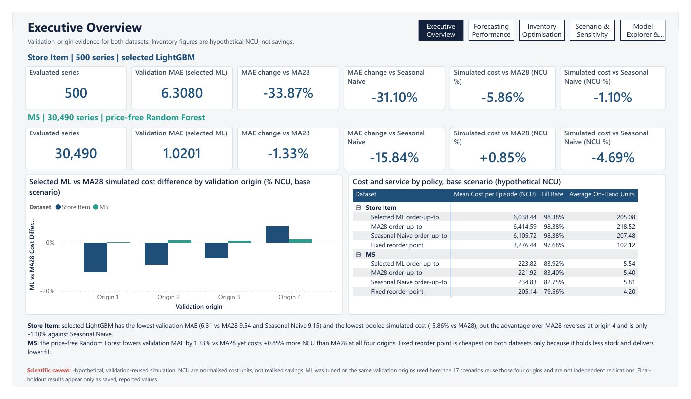
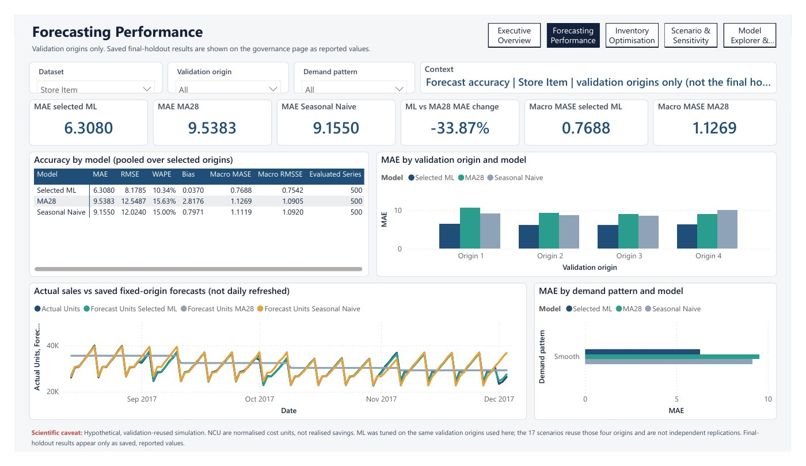
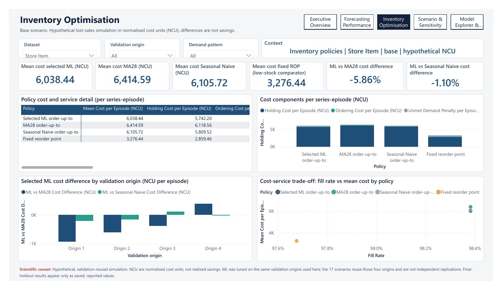
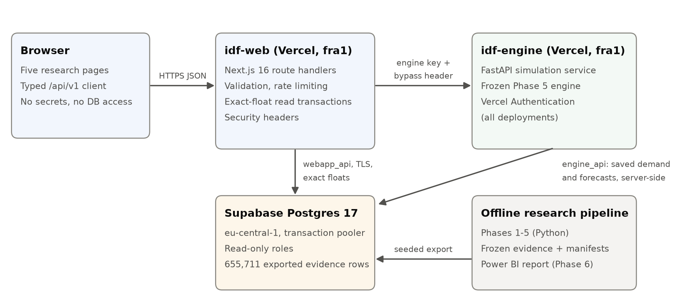

# Intelligent Demand Forecasting & Inventory Optimisation

Does machine learning forecast daily retail demand better than simple baselines, and what would the difference mean
for replenishment? This repository answers that question on two public retail datasets under one leakage-safe,
reproducible protocol, then tests the forecasts in a hypothetical inventory simulation.

**Live research app:** https://idf-web.vercel.app

**Status:** Phases 0–7 are complete and the Phase 8 submission package is prepared. The independent audit verdict
remains CONDITIONAL, with owner actions still open. See the
[full technical README](../README.md#project-status-by-phase).



## Key results

| | Store Item (500 regular series) | M5 / Walmart (30,490 intermittent series) |
|---|---|---|
| Selected model | LightGBM (global, recursive) | Random forest (global, recursive, price-free) |
| Final-holdout MAE vs best simple baseline | **5.43** vs 12.81 (−57.6% vs seasonal naive) | **1.047** vs 1.066 (−1.7% vs 28-day moving average) |
| Robust across metrics? | Yes | No: worse than MA28 on macro MASE |
| Simulated inventory cost vs MA28 (hypothetical) | Cheaper at 3 of 4 origins; reverses at the last | Costlier at all 4 origins |

**The lesson:** machine learning helped a lot where demand is regular and barely at all where it is intermittent
(68.8% of M5 series-days have zero sales). Better accuracy did not reliably lower simulated inventory cost, because
order-up-to policies react to the forecast level as well as to its error.

## What is in this repository

| Area | Contents |
|---|---|
| [`src/intelligent_demand/`](../src/intelligent_demand) | Data ingestion and audits, feature engineering, 15 forecasting methods (13 on full populations: naive and seasonal baselines, exponential smoothing, Croston/SBA/TSB, global random forest and LightGBM; ARIMA/SARIMA on declared series subsets), rolling-origin evaluation, inventory simulation |
| [`configs/`](../configs) | Experiment configurations |
| [`tests/`](../tests) | Offline test suite, including leakage tests that poison future values |
| [`powerbi/`](../powerbi) | Five-page Power BI report as a PBIP project (69 DAX measures, 43-rule QA) |
| [`apps/web/`](../apps/web) | Next.js 16 research app (Forecast Explorer, Inventory Planner, Scenario Comparison) |
| [`apps/engine/`](../apps/engine) | FastAPI service that runs the frozen inventory engine server-to-server |
| [`packages/inventory_core/`](../packages/inventory_core) | Vendored, byte-identical copy of the frozen simulation engine |
| [`docs/`](../docs) and [`reports/`](../reports) | Phase-by-phase methodology, results, audits and hash-bound evidence manifests |
| [`final_submission/`](../final_submission) | Research paper, viva deck, scientific and security audits, claim-to-evidence traceability |

## Method

1. **Data.** Store Item Demand Forecasting Challenge and M5 Forecasting Accuracy, both from Kaggle, audited for
   schema, completeness and exact quantities.
2. **Forecasting.** Every full-population method forecast all series 28 days ahead from four expanding validation
   origins. Features use only data strictly before each target date; prices were excluded because their
   publication timing could not be verified.
3. **Sealed final evaluation.** The model choice was frozen and fingerprinted, then scored once on a holdout
   recorded in a hash-chained ledger.
4. **Inventory simulation.** A deterministic lost-sales simulator ran four replenishment policies over 544 cases
   and 8.4 million series-episodes, in normalised cost units.
5. **Reporting.** A Power BI report and a deployed web app, both reconciled against the saved evidence.





## Research app architecture



- The Next.js front end reads curated evidence from PostgreSQL (Supabase) through read-only roles.
- The FastAPI engine is reachable only server-to-server; no credentials reach the browser.
- Live simulations were verified byte-for-byte against the local reference. Getting there exposed a
  float-precision defect (the database rounded to 15 digits, changing integer results for 182 of 3,200 cases),
  fixed with binary, exact-output float transport.

## Running it locally

Requirements: Python 3.11+ (developed on 3.14), Node.js 20+, a Kaggle account.

```powershell
python -m venv .venv
.\.venv\Scripts\python.exe -m pip install -e ".[dev,boosting]"
.\.venv\Scripts\python.exe -m pytest

# Data (not redistributed here): accept the competition rules on Kaggle first
.\.venv\Scripts\python.exe -m intelligent_demand download-data --dataset all
.\.venv\Scripts\python.exe -m intelligent_demand audit-store-item
```

Web app and engine: see the [application architecture](../docs/PHASE7_APPLICATION_ARCHITECTURE.md) and the
[deployment runbook](../docs/PHASE7D_DEPLOYMENT_RUNBOOK.md). Copy `.env.example` and supply your own database
settings; none are committed.

## Limitations

- Sales are a censored proxy for demand.
- The inventory study is hypothetical and reuses the validation windows, which favours ML.
- Four adjacent origins and one final window do not support significance claims.
- Costs are normalised units, not money; no savings are claimed.
- Results come from two public datasets and are not a universal ranking of methods.

## Data

The raw Kaggle data is **not** included; download it yourself under each competition's rules. The live app shows a
curated subset of daily sales for research demonstration only.

## Copyright

© 2026 Youssef Saeed. All rights reserved. The source is published for viewing and assessment only; no licence is
granted to use, copy, modify or redistribute it.

Author: [Youssef Saeed](https://youssefsaeed-portfolio.vercel.app).
