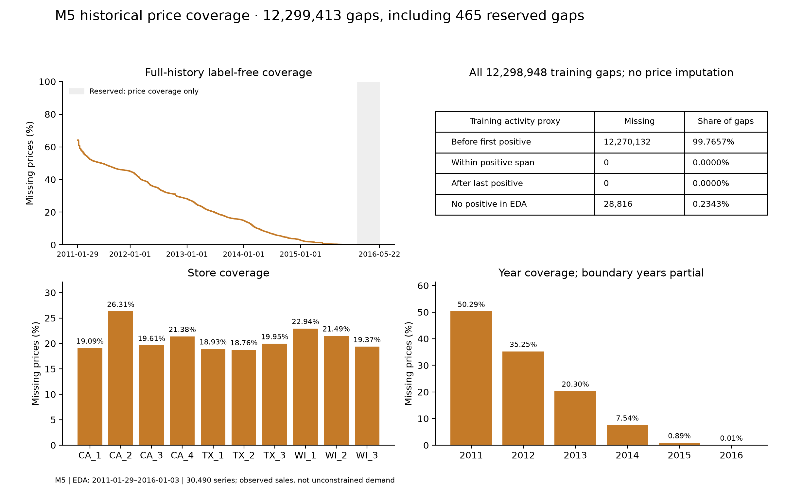

# Phase 2 EDA findings — 2026-11-06

Both verified datasets support separate daily forecasting benchmarks. Store Item has
regular, strongly seasonal sales; M5 combines sparse series, concentrated volume and
large calendar effects. These findings justify testing different model families. They
do not establish a winning forecasting method. No forecasting model was fitted or tuned.

## Scope and evidence

Before detailed analysis, date-only rules reserved four 28-day validation windows and
the final 28-day test. All series enter EDA; only the initial training prefix contributes
target distributions, classifications, seasonality, examples and demand/price activity.
The full-history exceptions are reconciliation to previously known Phase 1 counts,
sales totals and zero counts, and label-free historical price coverage. These exceptions
mean the holdout's global integrity totals are known; its detailed target behaviour has
not been explored for model selection. Competition test rows without labels remain excluded.

| Scope | Store Item | M5 |
|---|---:|---:|
| Full verified history | 2013-01-01–2017-12-31 | 2011-01-29–2016-05-22 |
| Full observations | 913,000 | 59,181,090 |
| Full sales units, reconciled | 47,704,512 | 66,927,173 |
| EDA dates | 2013-01-01–2017-08-13 | 2011-01-29–2016-01-03 |
| EDA days per series | 1,686 | 1,801 |
| Stores / products / series | 10 / 50 / 500 | 10 / 3,049 / 30,490 |
| EDA observations | 843,000 | 54,912,490 |
| EDA sales units | 43,666,945 | 61,066,490 |
| EDA zeros | 1 (0.000118624%) | 37,800,354 (68.837443%) |
| Median / 99th percentile / maximum daily units | 46 / 134 / 231 | 0 / 15 / 763 |
| Median per-series all-sales CV | 0.2877 | 2.0801 |
| Top 10% of products' share of units | 16.2760% | 51.6836% |

Quantiles use the inverse empirical CDF over every EDA observation, including zeros.
CV here is the standard deviation of all sales divided by their mean; the positive-size
CV² used below is a different statistic. Product shares aggregate the same product over
stores. The top group has ceil(0.1 × product count) products. Units and identities are
source-specific, so raw errors and raw totals must not be pooled across sources.

Evidence: [Store Item summary](../reports/eda/store_item_summary.md),
[M5 summary](../reports/eda/m5_summary.md),
[comparison](../reports/eda/cross_dataset_comparison.md), and their adjacent results JSON.

## Intermittency across the full series population

ADI = number of observed daily periods / number of positive observations. Positive-size
CV² = sample variance of positive sales (ddof=1) / squared mean positive sales. The
descriptive cutoffs are ADI=1.32 and CV²=0.49; equality belongs to the high group.
These conventions follow the [demand categorisation literature](https://doi.org/10.1057/palgrave.jors.2601841).
All-zero histories have undefined ADI/CV² and are reported separately; a single positive
observation has undefined sample variance and remains unclassified.

| EDA pattern | Store Item series | M5 series | M5 share |
|---|---:|---:|---:|
| Smooth: low ADI, low CV² | 500 | 983 | 3.22% |
| Erratic: low ADI, high CV² | 0 | 489 | 1.60% |
| Intermittent: high ADI, low CV² | 0 | 23,044 | 75.58% |
| Lumpy: high ADI, high CV² | 0 | 5,953 | 19.52% |
| All zero | 0 | 16 | 0.05% |
| Insufficient positive history | 0 | 5 | 0.02% |

Rounded percentages may not sum to 100%. M5's global zero rate alone would conceal
these differences. Leading zeros can reflect late introduction rather than intermittent
selling. Recomputing ADI from first positive sale through the same EDA end changes
1,288 M5 classifications: smooth 1,888, erratic 872, intermittent 22,139 and lumpy 5,570;
the 16 all-zero and 5 insufficient-history series remain separate. Store Item is unchanged.
Trailing zeros are retained in this sensitivity calculation. It does not reconstruct
actual assortment dates or availability. Calendar aggregation, nonstationarity and
sales censoring also limit the interpretation of fixed ADI/CV² thresholds. Classes are
descriptors, not a rule that selects the best model.


## Seasonality, trend and unusual observations

Store Item's within-week normalised Sunday ratio is 1.1916 (pointwise bootstrap 95%
interval 1.1872–1.1958), versus Monday 0.7913 (0.7879–0.7953). M5's Saturday ratio is
1.2104 (1.1995–1.2215), versus Wednesday 0.8749 (0.8631–0.8855). These measure aggregate
daily sales relative to each complete week's mean, rather than raw means confounded
by long-term growth. All seven weekday estimates and store-level profiles are exported.
The intervals use 500 moving-block resamples of four consecutive complete ISO weeks,
seed 42. They describe historical stability under that resampling assumption; they are
pointwise, exploratory and do not establish causality or future forecast accuracy.

Weekly robust STL variance-ratio strengths on log(1+aggregate units) are 0.9760 for
Store Item and 0.1093 for M5. After weekly removal, the 365-day diagnostic strengths
are 0.9933 and 0.7736. The calculation follows the
[seasonal-strength definition](https://otexts.robjhyndman.com/fpp3/stlfeatures.html).
Large M5 calendar extremes contribute to residual variance, so its low weekly strength
does not contradict stable weekday contrasts. These statistics are aggregate diagnostics,
not model scores. A fixed 365-day period approximates the leap calendar; monthly indices
are additionally normalised within complete years, excluding partial boundary years.

Median per-series lag-7 correlations are 0.7275 (Store Item) and 0.1750 (M5);
lag-365 medians are 0.5458 and 0.0304. Constant-series correlations remain undefined.
Raw-level correlation can reflect growth or assortment changes. Aggregate first-difference
log ACFs are exported alongside levels; no independent-white-noise significance bands
are asserted. Category/store trajectories, trailing 28-day means and rolling CVs document
nonconstant levels and variability without claiming formal structural breaks. Aggregate
28-day CV ranges are 0.1171–0.2357 for Store Item and 0.1168–0.2600 for M5.

Store Item's largest EDA observation is 231 units, store 2/item 15 on 2017-07-02.
M5's is 763 units, CA_3/FOODS_3_090 on 2013-09-14. Both are preserved and checked
against source CSVs. Large values alone do not establish data errors. The one Store Item
zero (store 6/item 4, 2014-01-15) is preserved; its cause is unknown. No historical
calendar gaps, duplicates or missing target values were found by Phase 1's independent gates.

M5 Christmas dates have mean aggregate sales of 15.6 units across five EDA dates,
compared with 21,130 on five Thanksgiving dates. Event and SNAP tables are descriptive
associations with small or confounded groups; overlapping events, growth, weekday and
assortment make causal attribution unjustified. Category and department daily totals
and state/SNAP summaries are retained for later origin-safe covariate research.


## M5 historical price investigation

All 12,299,413 full-history missing prices (20.782674%) remain null. Full-history
date/year/store/product marginals reconcile exactly. Missing counts decline from
5,167,100 in partial 2011 to 3,933,782 in 2012, 2,259,520 in 2013, 839,570 in 2014,
98,928 in 2015 and 513 in partial 2016. Boundary-year counts have different exposures;
figures show rates with observation denominators. Store and product detail is in the
saved price tables, including late-introduced products with high missing proportions.

| Mutually exclusive EDA activity partition | Missing-price observations |
|---|---:|
| Before first positive sale in EDA | 12,270,132 |
| Between first and last positive sale in EDA | 0 |
| After last positive sale in EDA | 0 |
| No positive sale anywhere in EDA | 28,816 |
| EDA total | 12,298,948 |

All EDA missing prices coincide with zero recorded sales; none coincide with positive
sales. This is consistent with introduction/assortment patterns, but observed first
sale is only a proxy. Neither absent prices nor zero sales prove out-of-stock status.
The remaining 465 missing prices fall in reserved validation/test dates. Only their
label-free coverage was examined: their relation to sales activity is deliberately
undetermined. Thus no whole-history activity claim is made. Do not fill prices with
zeros, backfill from future weeks, discard zeros, or infer stock availability. Future
price inputs require an explicit availability contract; default models use only prices
recorded by the origin, plus missingness indicators where appropriate.



## Forecasting implications and limits

Both datasets need naive, weekly seasonal naive and moving-average baselines. Store
Item supports weekly ETS, cautiously bounded SARIMA and global calendar/lag ML tests.
M5 motivates Croston/SBA/TSB candidates for appropriate sparse histories plus global ML
sharing information across series, with results stratified by training-only demand
pattern. Random Forest needs a memory budget; LightGBM is an optional future candidate,
not an installed/trained result. A large per-series SARIMA search over M5 is not a default.
See the [experimental protocol](FORECASTING_EXPERIMENTAL_PROTOCOL.md) for exact scopes,
fallbacks, multi-step rules, metrics, compute budgets and primary selection objective.

The shared daily store/product schema permits methodological replication. It does not
establish compatible item identities, unit semantics, price/event availability or
distributions for direct transfer. Store Item has only IDs/date; M5 adds hierarchy,
events/SNAP and historical weekly prices. Aggregate seasonality must not be assumed
to apply equally to sparse leaf series. Both sources observe sales, potentially
constrained demand. M5's leading-zero sensitivity and the seasonal position of four
contiguous validation windows limit generalisation beyond these particular histories.

## Reproduction and validation

```powershell
.\.venv\Scripts\python.exe -m intelligent_demand eda --dataset all --settings configs/eda.yaml
.\.venv\Scripts\python.exe -m ruff check .
.\.venv\Scripts\python.exe -m pytest -p no:cacheprovider --basetemp=.venv/pytest-phase2
.\.venv\Scripts\python.exe -m pip check
```

The EDA command reads audited immutable Parquet, projects five columns and scans
65,536-row batches. Only the training-prefix numeric matrix and bounded diagnostic
blocks are retained; no 59-million-row Pandas table is constructed. All series enter
population aggregates. Representative plots use deterministic median-ranked members
of each class; their displayed traces are examples, not sample estimates of population
statistics. Bootstrap sampling is separately declared above.

The actual combined run took 132.60 seconds and peaked at 1,205,829,632 bytes (1.123 GiB)
of worker Windows working set. Store analysis took 13.76 seconds; M5 analysis 80.79 seconds;
the balance includes figures/reports. These are observed process measurements, not a
guarantee for another machine or total system RAM. Figure layout was subsequently
regenerated from the unchanged saved tables, without repeating M5 analysis.

Outputs comprise 39 reusable Parquet tables and 24 figures in both PNG and SVG (48
image files), two dataset reports, a comparison, settings/split manifests and validation
JSON. [Validation evidence](../reports/eda/validation.json) checks saved marginal sums,
zero counts, all-series coverage, training date boundaries, price partitions and raw/
canonical hashes. [Run manifest](../reports/eda/run_manifest.json) records code hashes,
settings, environment and runtime; it identifies a dirty working tree because Phase 2
has not been committed. Source and canonical files remain unchanged. No invented values,
imputations, acquisition or canonical transformation occurred.

Phase 2 is ready for review when the accompanying automated checks pass. This does
not authorise Phase 3. The independent Claude audit remains a future gate after Phase 4
and before Phase 5, as recorded in [ROADMAP.md](ROADMAP.md).

## Final visual presentation enhancement

The original analytical run and its 24-figure manifest above are preserved as historical
execution evidence. The enhanced presentation now contains **29 figures / 58 PNG/SVG
files**, generated entirely from the same 39 saved analytical tables. No EDA quantity,
ADI/CV² classification, source/canonical data or proposed split has changed.

Store Item's CV histogram now uses decimal linear ticks, the one zero is explicitly
annotated, and its entirely smooth population is described without empty class bars.
M5's scatter and class-distribution figures are separate; minority groups have exact
counts/shares. Price categories show exact counts and shares rather than hiding small
groups behind a dominant bar. Zero/single-positive representative examples now show full
training histories, with nonnegative axes and explicit date windows. Event/category
labels and small-value annotations are readable.

New SNAP plots divide units by observed state/flag store-days. New department plots
divide each department's daily units by its number of published store/product series;
partial boundary months are labelled. These are descriptive rates, not causal effects
or independently observed assortment measures. New extreme-value plots use the exact
full-population histogram for tail probabilities and explicitly label the retained
top-20 examples; ties are not exhaustive and high values are not diagnosed as errors.

The [offline visual report](../reports/eda/EDA_VISUAL_REVIEW.html) supplies a Key Finding
and Forecasting Implication for every chart, with coverage and limitations. The
[visual QA summary](../reports/eda/VISUAL_QA_SUMMARY.md) records checks and remaining
interpretation limits. Current renderer hashes belong to visualisation_audit.json;
run_manifest.json retains the original analytical run's source hashes and revision.
