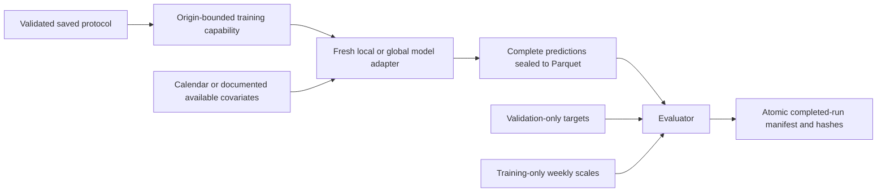

# Phase 3A forecasting infrastructure

This layer implements contracts, validation orchestration and persistence. It contains
**no forecasting method**, trained model, search procedure or real-data benchmark.
The production model registry is empty. Synthetic fixture doubles exercise lifecycle
hooks without learning parameters. Phase 3B–3E remain unstarted.

The [existing experimental protocol](FORECASTING_EXPERIMENTAL_PROTOCOL.md) remains the
source of truth. Its original Markdown and saved split manifest are unchanged.

## Components and control flow

| Component | Implementation | Responsibility |
|---|---|---|
| Configuration | experiments/config.py; configs/forecasting.yaml | Strict schema, resources, seed, season and immutable protocol horizon |
| Origins | evaluation/splits.py; existing evaluation/design.py | Validate the saved four expanding origins per source |
| Model capability | experiments/data.py | Projected, bounded historical reads and availability-checked future covariates |
| Model registration | models/base.py | Identifier/version, local/global scope, fresh-instance fit/predict lifecycle |
| Prediction publication | evaluation/predictions.py | Unique complete keys, 28 steps, raw/clipped values and atomic Parquet |
| Scoring | evaluation/scoring.py; existing evaluation/metrics.py | Training-only scales, alignment, pooled/macro/class/horizon summaries |
| Registry | experiments/registry.py | Immutable specification, exclusive attempt owner, status and output hashes |
| Orchestration | experiments/engine.py | Future model execution, sealed predictions before target access, provenance |



The final holdout has no target-reading or scoring API in this phase. Read-only CLI
commands validate plans, list registrations and inspect run metadata; none fit a model.

## Frozen origins

Each source starts training at its first labelled date. Training includes the origin;
the next 28 consecutive days are validation. Later origins may train on earlier
validation periods, reflecting information available by that later date.

| Fold | Store Item origin | Store Item validation | M5 origin | M5 validation |
|---|---|---|---|---|
| 1 | 2017-08-13 | 2017-08-14–2017-09-10 | 2016-01-03 | 2016-01-04–2016-01-31 |
| 2 | 2017-09-10 | 2017-09-11–2017-10-08 | 2016-01-31 | 2016-02-01–2016-02-28 |
| 3 | 2017-10-08 | 2017-10-09–2017-11-05 | 2016-02-28 | 2016-02-29–2016-03-27 |
| 4 | 2017-11-05 | 2017-11-06–2017-12-03 | 2016-03-27 | 2016-03-28–2016-04-24 |

Training starts: Store Item 2013-01-01; M5 2011-01-29. Protected final tests are
2017-12-04–2017-12-31 and 2016-04-25–2016-05-22 respectively. ValidationFold rejects
altered origins, a fifth fold, changed holdout boundaries or changed date coverage.
Public data, prediction and scoring entry points revalidate the concrete frozen fold;
duck-typed substitutes and modified fold fields cannot move access boundaries.
`load_splits` reads configurable manifest paths but requires exactly the saved Phase 2
content. Changing the scientific protocol requires a separate explicit decision.

## Data and feature availability

`ParquetSource.at_origin(fold, series)` returns an `OriginData` capability. Its `history`
method defaults to keys and observed sales, selects columns explicitly and cannot request
dates after the origin. Date, source and series predicates are applied in the Arrow
scanner before batches become model-visible Pandas frames. No 59-million-row DataFrame
is built. Physical Parquet row groups can straddle cutoffs; Arrow filters their decoded
records before exposing model batches. The protection concerns observable records.

Static metadata is derived only from origin-visible records, must cover all declared
series and must be a unique many-to-one mapping. Changing static values fail validation.
The published benchmark universe is assumed known, including all-zero histories; it
does not imply observed product availability or future activity.

Default future features contain only series/date/horizon keys and deterministic weekday
and month. Extra columns require an `Availability` rule with a publication/issue date
no later than the origin and nonempty evidence. Supported declarations are known-future,
static or independently forecast covariates; observed unknown-future values are rejected.
Independent covariate forecasting itself is not implemented. Evidence is supplied by a
trusted adapter and must be reviewed: a label cannot establish operational availability.
No default future prices, events or SNAP inputs are enabled.

The model wrapper revalidates future feature grids and rejects target columns. It accepts
only an `OriginData` object for fit, never an arbitrary full-history DataFrame. This gives
fold-local access for encoders, target transforms, imputers and other preprocessing.
Future lag/rolling implementations must remain within that capability: recursive
multi-step models may use their earlier predictions, never actual post-origin sales.
Actual lag/rolling features and preprocessing algorithms belong to later phases.

`history_before(training_target_date)` provides strictly prior observations for a
training row. `validate_training_feature_lineage` checks declared maximum source dates
against each target date and the origin; unshifted rolling features and future lag
lineage fail. This validates provenance without generating actual lag/rolling features.
Future builders must use this guard and remain responsible for truthful lineage.

These are strict trusted-plugin API contracts, not an operating-system sandbox for
arbitrary Python. Adapters must not bypass them with unrelated filesystem reads,
externally fitted preprocessing or unreviewed feature availability claims.

## Model lifecycle

Implement a future `ForecastModel` subclass with `_fit(training_data, configuration)`
and `_predict(forecast_origin, horizon, available_features)`. Its public methods enforce
fresh state, exactly 28 steps and matching origin/feature scope. Configuration is copied
through canonical JSON so adapter mutation cannot change the registry specification.
No adapter may silently override experiment seed or thread policy.

Register a factory under a unique identifier/version and declare `local` or `global`.
The engine creates one fresh local instance per series, or one global instance per
dataset/origin. Reusing a fitted instance is rejected. The identifier/version and
configuration accompany persisted outputs. Adapter-specific package versions and
recursive/fallback behaviour must be added and tested with the later implementations.

Optional `save_artifacts(directory)` returns paths confined to that supplied directory;
relative paths resolve there. Outputs outside it, partial files and missing files cannot
be published. No model artefacts are created from real data during Phase 3A.

## Prediction and evaluation contracts

Model output batches contain `series_id`, `target_date`, `prediction`, plus optional
boolean `is_fallback`. All other prediction metadata is attached by infrastructure.
The writer validates keys within and across batches using a series × 28 boolean grid.
Unknown, duplicate, missing or extra series/dates fail. Empty/incomplete outputs remain
`.parquet.part` and cannot be treated as complete.

Published columns: dataset_id, series_id, forecast_origin, target_date, horizon_step,
model_id, model_version, run_id, prediction, raw_prediction, is_fallback and was_clipped.
Dates are naive daily date32; predictions are finite float64; no integer rounding is
applied. The predeclared common nonnegative clipping policy retains raw predictions
and clipping incidence. Actual targets never enter the model prediction file.
Prediction streams are flushed and synced before the atomic rename. Failed renames
leave only the unpublished partial file. Feature keys are checked after date
normalisation so equivalent timestamp strings cannot disguise duplicate keys.

The evaluator requests validation targets only after prediction publication. It requires
one-to-one complete alignment with the same source, origin, population and 28 dates.
Missing or invalid values produce a failed run, not a score on a convenient subset.
Fallback/clipping counts, defined/undefined scaled-metric counts and observation/series
coverage accompany every successful summary. See [METRIC_DEFINITIONS.md](METRIC_DEFINITIONS.md).
Class labels require matching series coverage and an as-of date no later than the origin.
Absent labels are explicitly `unclassified`; no future target-derived classes are inferred.

## Registry, interruption and safe resume

Each run gets a random UUID and deterministic specification SHA-256. The specification
contains model configuration, source, origin/window, protocol hash, population/class
fingerprints, seed, settings, canonical source-file fingerprint and code provenance.
Record the current Git revision and dirty state plus source hashes and package versions;
missing code provenance is rejected. Fixture tests use explicitly synthetic version IDs.

Run layout under ignored `artifacts/experiments/forecasting/`:

```text
<run_id>/specification.json
<run_id>/status.json
<run_id>/execution.lock                   only while owned
<run_id>/attempts/<attempt_id>/predictions.parquet[.part]
<run_id>/attempts/<attempt_id>/metrics.json
<run_id>/attempts/<attempt_id>/model_metadata.json
<run_id>/attempts/<attempt_id>/models/... optional
```

Statuses are pending, running, completed, failed and interrupted. Metadata writes are
atomic; an exclusive lock prevents concurrent owners. Completion is the last atomic
manifest write, after validated predictions, scores and metadata exist. Completed
outputs are checksum-verified before reuse, and the current source fingerprint must
still match. Tampered, missing or escaped output paths are rejected.
Verification also requires all three mandatory outputs and a valid recorded attempt;
an empty completed manifest is rejected. `comparison_candidates(run_ids)` admits only
checksum-verified completed runs with identical source, fold, population, classes,
protocol, seed, settings and code provenance. It does not sort scores or select a model;
future ranking code must use this eligibility gate and validate four-fold coverage.

Caught KeyboardInterrupt/SystemExit marks interrupted; other execution exceptions mark
failed. A failed/interrupted restart requires `resume=True`, an identical specification
and a **new attempt from the beginning**. Partial predictions and model states are never
merged into the new attempt. Old partial files are preserved for inspection.

A hard kill may leave running state and a lock. Recovery is never automatic by elapsed
time. `recover_interrupted` requires the recorded owner token and explicit confirmation
that the owner has stopped. Do not provide that confirmation for a live process. This
operator action is not exposed as a casual CLI switch in Phase 3A.

## Resources and commands

History reads are projected and streamed with configurable batch rows (default 65,536),
without threaded Arrow scans. Training scales keep seven values plus accumulators per
series. The scheduler currently runs serially; worker count is a validated capacity
ceiling, not a claim of an implemented parallel scheduler. Model adapters receive a
four-thread maximum and must respect it. GPU training and hard process/time enforcement
are not implemented. Their model-specific resource tests remain future work.

Prediction writes are batched. The evaluation join is bounded by a configurable row
budget (default one million; M5's 30,490 × 28 = 853,720 fits). Both declared population
and actual rows are checked. Grouped metrics are vectorised; per-series records are
stored once rather than repeated for every horizon. No real-scale time/memory benchmark
was executed during this infrastructure phase.

```powershell
.\.venv\Scripts\python.exe -m intelligent_demand forecast-plan
.\.venv\Scripts\python.exe -m intelligent_demand forecast-models
.\.venv\Scripts\python.exe -m intelligent_demand experiment-status --run-id <existing-run-id>
```

The first two commands require only configuration and saved protocol metadata; they
do not read canonical sales or create experiment runs. All current CLI commands added
in Phase 3A are read-only. No forecasting execution CLI is supplied yet. Importing the
engine or registering a factory does not execute it. Review Phase 3A before authorising
Phase 3B. The independent Claude audit still follows Phase 4 and precedes Phase 5.

Integrity findings and readiness limits: [PHASE3A_INTEGRITY_REVIEW.md](PHASE3A_INTEGRITY_REVIEW.md).
