# Phase 6 data dictionary and lineage

Generated by `python -m intelligent_demand.bi.export` and `python -m intelligent_demand.bi.docs`.
Every table is a compact CSV in `artifacts/powerbi/data/` (git-ignored, reproducible). Row counts and
SHA-256 values come from `reports/powerbi/data_manifest.json`. No final-holdout target was read.

## Lineage

Saved Phase 3-5 evidence -> `bi/export.py` (read-only, hash-checked adapters) -> reporting CSVs ->
Power Query `LoadReportingTable` (explicit types, early projection, empty text kept as null) ->
TMDL star schema -> DAX measures in `_Measures` -> PBIR report pages.

Source fingerprints:

- `audit_response`: `docs/PHASE5_AUDIT_RESPONSE.md` sha256 `fb52a784c6f664d4...`
- `execution_contract`: `artifacts/inventory/phase5/execution.json` sha256 `b38f5545ac883741...`
- `final_evaluation`: `artifacts/experiments/phase4/final_evaluation.json` sha256 `8c6011a255af5070...`
- `frozen_plan`: `artifacts/inventory/phase5/plan.json` sha256 `28f6ec4b28bfee40...`
- `frozen_selection`: `artifacts/experiments/phase4/frozen_selection.json` sha256 `a7f4bc10beb8ed8a...`
- `phase5_audit_summary`: `reports/inventory/phase5_summary.json` sha256 `1d817e56a6aa590d...`
- `reporting_config`: `configs/powerbi.yaml` sha256 `064d65e6973ae6c8...`
- `trial_leaderboard`: `artifacts/experiments/phase4/trial_leaderboard.json` sha256 `219700b360f66a27...`

## Tables

| Table | Grain | Business key | Rows |
|---|---|---|---:|
| DimAuditFinding | One row per independent audit finding | FindingId | 12 |
| DimDataset | One row per dataset | DatasetKey | 2 |
| DimDate | One row per calendar day 2016-2017 | Date | 731 |
| DimDemandPattern | One row per training-prefix demand pattern | PatternKey | 6 |
| DimForecastModel | One row per dataset and forecast model role | ModelKey | 6 |
| DimInventoryPolicy | One row per inventory policy | PolicyKey | 4 |
| DimLimitation | One row per declared scientific limitation | LimitationId | 8 |
| DimScenario | One row per frozen hypothetical scenario | ScenarioKey | 17 |
| DimSeries | One row per dataset series | SeriesKey | 30,990 |
| DimValidationOrigin | One row per dataset validation origin | OriginKey | 8 |
| FactFinalHoldoutReported | One row per saved final assessment | TrialId | 8 |
| FactForecastDaily | Validation origin x model role x demand pattern x target date | OriginKey, ModelKey, PatternKey, Date | 2,352 |
| FactForecastSeriesDaily | Detail series x origin x model role x target date | SeriesKey, OriginKey, ModelKey, Date | 170,016 |
| FactForecastSeriesOrigin | Series x validation origin x model role (28 observations each) | SeriesKey, OriginKey, ModelKey | 371,880 |
| FactInventoryScenarioResults | Inventory case (origin x scenario x policy) x demand pattern | OriginKey, ScenarioKey, PolicyKey, PatternKey | 1,904 |
| FactInventorySeriesBase | Series x origin x policy, base scenario only | SeriesKey, OriginKey, PolicyKey | 495,840 |
| FactModelSelectionTrials | One row per Phase 4 trial | TrialId | 27 |
| FactScientificValidation | One row per verification receipt | CheckId | 8 |

## Relationships

All are many-to-one, single direction, active. Dimensions never filter each other, so there are
no ambiguous paths; demand pattern and dataset are denormalised onto DimSeries as attributes only.

```mermaid
erDiagram
    DimSeries ||--o{ FactForecastSeriesOrigin : "SeriesKey"
    DimValidationOrigin ||--o{ FactForecastSeriesOrigin : "OriginKey"
    DimForecastModel ||--o{ FactForecastSeriesOrigin : "ModelKey"
    DimDataset ||--o{ FactForecastSeriesOrigin : "DatasetKey"
    DimDemandPattern ||--o{ FactForecastSeriesOrigin : "PatternKey"
    DimValidationOrigin ||--o{ FactForecastDaily : "OriginKey"
    DimForecastModel ||--o{ FactForecastDaily : "ModelKey"
    DimDataset ||--o{ FactForecastDaily : "DatasetKey"
    DimDemandPattern ||--o{ FactForecastDaily : "PatternKey"
    DimDate ||--o{ FactForecastDaily : "Date"
    DimSeries ||--o{ FactForecastSeriesDaily : "SeriesKey"
    DimValidationOrigin ||--o{ FactForecastSeriesDaily : "OriginKey"
    DimForecastModel ||--o{ FactForecastSeriesDaily : "ModelKey"
    DimDataset ||--o{ FactForecastSeriesDaily : "DatasetKey"
    DimDemandPattern ||--o{ FactForecastSeriesDaily : "PatternKey"
    DimDate ||--o{ FactForecastSeriesDaily : "Date"
    DimValidationOrigin ||--o{ FactInventoryScenarioResults : "OriginKey"
    DimScenario ||--o{ FactInventoryScenarioResults : "ScenarioKey"
    DimInventoryPolicy ||--o{ FactInventoryScenarioResults : "PolicyKey"
    DimDataset ||--o{ FactInventoryScenarioResults : "DatasetKey"
    DimDemandPattern ||--o{ FactInventoryScenarioResults : "PatternKey"
    DimSeries ||--o{ FactInventorySeriesBase : "SeriesKey"
    DimValidationOrigin ||--o{ FactInventorySeriesBase : "OriginKey"
    DimInventoryPolicy ||--o{ FactInventorySeriesBase : "PolicyKey"
    DimDataset ||--o{ FactInventorySeriesBase : "DatasetKey"
    DimDemandPattern ||--o{ FactInventorySeriesBase : "PatternKey"
    DimDataset ||--o{ FactModelSelectionTrials : "DatasetKey"
    DimDataset ||--o{ FactFinalHoldoutReported : "DatasetKey"
```

## Columns

### DimAuditFinding

The 12 independent-audit findings and their recorded dispositions.

Columns (hidden: none): `FindingId`, `Severity`, `Finding`, `Disposition`, `Status`

### DimDataset

One row per dataset. Filters every fact through DatasetKey.

Columns (hidden: DatasetKey, DatasetSort): `DatasetKey`, `Dataset`, `DatasetSort`, `DatasetDescription`, `SeriesCount`, `SelectedTrial`, `TrainingStart`

### DimDate

Calendar for 2016-2017; only validation-window dates carry fact rows.

Columns (hidden: MonthNumber, DayOfWeekNumber): `Date`, `Year`, `MonthNumber`, `Month`, `YearMonth`, `DayOfWeekNumber`, `DayOfWeek`, `IsWeekend`

### DimDemandPattern

Training-prefix demand classification from the Phase 2 EDA.

Columns (hidden: PatternKey, PatternSort): `PatternKey`, `DemandPattern`, `PatternSort`, `PatternDescription`

### DimForecastModel

One row per dataset and forecast model role (Selected ML, MA28, Seasonal Naive).

Columns (hidden: ModelKey, DatasetKey, ModelRoleKey, ModelRoleSort): `ModelKey`, `DatasetKey`, `ModelRole`, `ModelRoleKey`, `ModelRoleSort`, `Algorithm`, `IsSelectedModel`, `ModelDescription`, `ValidationRunIds`

### DimInventoryPolicy

One row per Phase 5 inventory policy. Fixed reorder point is a low-stock, lower-service comparator.

Columns (hidden: PolicyKey, PolicySort, ForecastRoleKey): `PolicyKey`, `Policy`, `PolicySort`, `ForecastRoleKey`, `PolicyDescription`, `IsLowStockComparator`

### DimLimitation

Declared scientific limitations that every interpretation must carry.

Columns (hidden: none): `LimitationId`, `Limitation`, `SourceDocument`

### DimScenario

One row per frozen hypothetical scenario (base plus 16 one-at-a-time changes). Not independent replications.

Columns (hidden: ScenarioKey, ScenarioSort): `ScenarioKey`, `Scenario`, `ScenarioGroup`, `ScenarioSort`, `ChangedParameter`, `IsBase`, `LeadDays`, `ReviewDays`, `BufferDays`, `InitialCoverDays`, `HoldingCost`, `ShortageCost`, `FixedOrderCost`, `VariableOrderCost`, `TerminalCost`, `VariabilityMultiplier`

### DimSeries

One row per series (500 Store Item, 30,490 M5). Demand pattern is an attribute only, to avoid ambiguous paths.

Columns (hidden: SeriesKey, DatasetKey, PatternKey): `SeriesKey`, `DatasetKey`, `SeriesId`, `StoreId`, `ItemId`, `DepartmentId`, `CategoryId`, `StateId`, `PatternKey`, `TrainingPrefixUnits`, `TrainingPrefixMeanUnits`, `RetrospectiveSparseGroup`, `HasDailyDetail`

### DimValidationOrigin

One row per dataset validation origin (four expanding origins per dataset). Never the final holdout.

Columns (hidden: OriginKey, DatasetKey): `OriginKey`, `DatasetKey`, `Fold`, `FoldLabel`, `OriginDate`, `ValidationStart`, `ValidationEnd`, `TrainStart`, `OriginLabel`

### FactFinalHoldoutReported

Saved Phase 4 one-time final-holdout results, reported exactly as recorded. Not a new evaluation and never recomputed.

Columns (hidden: DatasetKey): `DatasetKey`, `TrialId`, `Algorithm`, `Role`, `EvidenceType`, `MacroMAE`, `MacroMASE`, `MacroRMSSE`, `PooledRMSE`, `PooledWAPEPercent`, `Series`, `Observations`

### FactForecastDaily

Validation origin x model role x demand pattern x date. Additive daily components for actual-versus-forecast charts.

Columns (all hidden (use measures)): `OriginKey`, `ModelKey`, `DatasetKey`, `PatternKey`, `Date`, `Series`, `SumActual`, `SumForecast`, `SumAbsError`, `SumSquaredError`, `SumError`

### FactForecastSeriesDaily

Daily actual and forecast for detail series only (all Store Item series; the six predeclared M5 representatives).

Columns (all hidden (use measures)): `SeriesKey`, `OriginKey`, `ModelKey`, `DatasetKey`, `PatternKey`, `Date`, `HorizonDay`, `Actual`, `Forecast`

### FactForecastSeriesOrigin

Series x validation origin x model role. Additive error components over 28 daily observations, plus origin-bounded MASE/RMSSE scales.

Columns (all hidden (use measures)): `SeriesKey`, `OriginKey`, `ModelKey`, `DatasetKey`, `PatternKey`, `Observations`, `SumAbsError`, `SumSquaredError`, `SumError`, `SumActual`, `SumForecast`, `ScaleAbs`, `ScaleSquared`, `OriginSampleAllZero`

### FactInventoryScenarioResults

Inventory case (origin x scenario x policy) x demand pattern. Additive hypothetical NCU costs and units from Phase 5.

Columns (all hidden (use measures)): `CaseId`, `DatasetKey`, `OriginKey`, `ScenarioKey`, `PolicyKey`, `PatternKey`, `DemandUnits`, `FulfilledUnits`, `UnmetUnits`, `ReceivedUnits`, `PlacedUnits`, `HoldingCost`, `ShortageCost`, `OrderingCost`, `TerminalCost`, `TotalCost`, `StockoutDays`, `Orders`, `AverageOnHandSum`, `AverageInventoryPositionSum`, `FinalOnHand`, `FinalPipeline`, `InitialOnHand`, `SeriesEpisodes`

### FactInventorySeriesBase

Series x origin x policy for the base scenario only. Supports paired series comparisons.

Columns (all hidden (use measures)): `SeriesKey`, `DatasetKey`, `OriginKey`, `PolicyKey`, `PatternKey`, `DemandUnits`, `FulfilledUnits`, `UnmetUnits`, `ReceivedUnits`, `PlacedUnits`, `HoldingCost`, `ShortageCost`, `OrderingCost`, `TerminalCost`, `TotalCost`, `StockoutDays`, `Orders`, `AverageOnHand`, `AverageInventoryPosition`, `FinalOnHand`, `FinalPipeline`, `InitialOnHand`, `ForecastMAE`, `OriginSampleAllZero`

### FactModelSelectionTrials

Phase 4 tuning and reference trials with their saved four-origin validation scores (reported).

Columns (hidden: DatasetKey): `TrialId`, `DatasetKey`, `TrialKind`, `Algorithm`, `ValidationMacroMAE`, `ValidationMacroMASE`, `ValidationMacroRMSSE`, `ValidationPooledRMSE`, `ValidationPooledWAPEPercent`, `ValidationBiasUnits`, `Observations`, `FallbackObservations`, `IsSelected`

### FactScientificValidation

One row per saved verification receipt; status copied from the receipt.

Columns (hidden: none): `CheckId`, `Check`, `Status`, `EvidencePath`, `EvidenceSha256`
