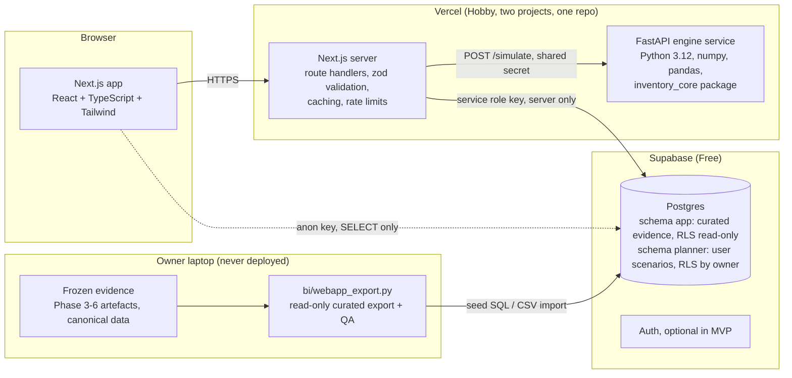

# Phase 7A: application architecture

> **Amended by Phase 7B (2026-11-12):** the implementation refines this design (no browser database access, dedicated least-privilege roles instead of the service-role key, Postgres-backed rate limiting, `/api/v1` routes, measured 137 MB footprint). See [PHASE7B_BACKEND_RESULTS.md](PHASE7B_BACKEND_RESULTS.md) section 3.

Status: design only (2026-11-11). Nothing has been scaffolded, deployed or provisioned. Git HEAD at the
time of writing: `987e27f8a56cde6617e44ad8795feec9b97218ef` (Phase 6 checkpoint). Phase 7 has not started.

Companion documents: [data contract](PHASE7_DATA_CONTRACT.md), [Supabase schema](PHASE7_SUPABASE_SCHEMA_DESIGN.md),
[API](PHASE7_API_SPECIFICATION.md), [UI/UX](PHASE7_UI_UX_SPECIFICATION.md),
[deployment feasibility](PHASE7_DEPLOYMENT_FEASIBILITY.md), [implementation plan](PHASE7_IMPLEMENTATION_PLAN.md),
[quality gates](PHASE7_QUALITY_GATES.md).

## 1. What the application is

An interactive, read-mostly scientific decision-support site with one genuinely interactive computation: a
bounded inventory simulation that runs the unchanged Phase 5 Python engine on saved validation demand and
saved forecasts. Everything else (forecasts, accuracy metrics, the 544-case scenario study, audit findings,
limitations) is frozen evidence served from curated tables.

Non-goals: no training, tuning, forecast regeneration, holdout access, new model selection or editing of
scientific evidence from the application.

## 2. Integration surface audit (what exists and can be reused)

| Existing asset | Grain / size | Reusable as-is | Gap for the app |
|---|---|---|---|
| `artifacts/powerbi/data/*.csv` (18 tables, manifest-hashed) | see data dictionary | Dimensions, scenario results (1,904 rows), aggregate daily errors by pattern, trials, reported final-holdout rows, limitations, findings | Built for a BI model, not for per-series API reads |
| `FactForecastSeriesDaily` | 170,016 rows: all 500 Store Item series + 6 M5 representatives x 4 origins x 3 models x 28 days (actual + forecast) | Store Item explorer and planner inputs | M5 covers only 6 series; no pre-origin history for charts |
| `FactForecastSeriesOrigin` | 371,880 rows, additive error components + MASE/RMSSE scales | Full-population aggregates (precompute, do not ship whole) | Too large to query per request from a free Postgres without indexes; ship curated subset plus precomputed aggregates |
| `FactInventorySeriesBase` | 495,840 rows, base scenario per series x origin x policy | Parity reference for the planner; curated subset for "compare with the study" | Lacks `historical_mean56`, which the engine needs for buffer and initial stock |
| Phase 5 per-case Parquet (`artifacts/inventory/phase5/runs/*`) | 544 cases | Parity fixtures | Local only, never shipped |
| `inventory/engine.py` + `design.py` | 220 + 69 lines; numpy, pandas, PyYAML only | The simulation engine, unchanged | Needs a JSON wrapper and an installable package |
| Canonical `data/processed/*/daily_sales.parquet` | 913k and 59.2M rows | Source for a bounded pre-origin history export (training side only) | Never shipped; export must stop at each origin and never touch the holdout window |
| Phase 4 registry predictions, frozen selection, ledger | protected | Provenance hashes only | Never shipped |

Additional lightweight exports required (built in 7B by a new `bi/webapp_export.py`, read-only):

1. Curated M5 series manifest (deterministic, predeclared, pattern-stratified; see data contract).
2. Pre-origin history window (84 days) and validation-window actual demand for every curated series and origin.
3. `historical_mean56` per series and origin (already computed by the Phase 5 adapter; copy, do not recompute).
4. Full-population forecast-accuracy aggregates by dataset, origin, model and pattern.
5. Provenance record: plan, execution, selection and ledger hashes, Phase 6 manifest hash, export timestamp.

## 3. Selected architecture

Primary: **Option A, two Vercel projects from one monorepo** (Next.js web app plus a small FastAPI engine
service), Supabase Postgres for curated data, no always-on server.



Why two projects rather than Vercel Services: Services (one project, several runtimes) is in Beta on all
plans as of the 2026-08-10 docs. Two projects use only generally available features, cost the same on Hobby,
and can be merged into Services later without code changes. Fallbacks are in the feasibility document.

### Responsibility split

| Concern | Where | Why |
|---|---|---|
| Reading curated evidence | Next.js route handlers via Supabase server client; public pages may also read with the anon key through RLS | Simple, cacheable, no Python needed |
| Aggregating metrics | Precomputed tables, never on request | Full-population sums are frozen; recomputing per request is wasteful and risks drift |
| Inventory simulation | FastAPI service running `inventory_core.simulate` | Scientific fidelity: the validated engine, byte-identical |
| Input validation and bounds | Both: zod in Next.js, Pydantic plus the engine's own `Scenario` validation in Python | Defence in depth |
| Realised demand for the simulation | Loaded by the engine service from Supabase (server role), never accepted from the client | Users cannot inject future demand or alter the path |
| User scenario persistence | Supabase `planner` schema, authenticated users only (post-MVP) | Public demo needs no accounts |
| Charts and exports | Client (SVG charts, PNG download) and Next.js (CSV of a bounded run) | No server rendering of images |
| Secrets | Vercel encrypted environment variables; service-role key and engine secret server-only | Never in the client bundle or Git |

### The eight design questions

1. **Next.js server functions** run data reads, validation, caching, rate limiting, CSV export and the proxy to the engine.
2. **Python is required** only for the inventory simulation. No forecasting runs anywhere: forecasts are saved artefacts.
3. **Precomputed**: all forecasts, all accuracy metrics (per curated series and full-population aggregates), the 544-case scenario study, base per-series inventory results for curated series.
4. **Interactive**: one series x one origin x 28 days x up to four policies x one user scenario per request (about 0.4 s CPU, under 5 MB).
5. **Persisted**: curated evidence (immutable), provenance, and later user scenarios/runs. MVP planner runs are stateless.
6. **Stateless**: every API handler and the engine service.
7. **Cached**: reference tables and per-series forecast payloads (immutable, long `Cache-Control` plus Next.js data cache); aggregates; not planner runs.
8. **Never exposed**: canonical datasets, holdout-window data, model artefacts, registry, ledger, local paths, service-role key, engine secret, raw error traces.

## 4. Python engine packaging

Create an installable package `packages/inventory_core/` containing byte-identical copies of
`src/intelligent_demand/inventory/engine.py` and `design.py` (the latter minus `load_design`, which needs
YAML and the Phase 5 config and is not used by the service). The originals are part of the Phase 5
execution contract and must not be edited or moved.

Required interface additions (wrapper, not engine changes):

```python
# packages/inventory_core/service.py (new; engine.py and design.py unchanged)
@dataclass(frozen=True)
class PlannerRequest:
    dataset: str; series_key: str; origin_key: str
    forecast_roles: tuple[str, ...]          # subset of ("selected_ml","moving_average_28","seasonal_naive")
    include_fixed_reorder_point: bool
    scenario: Scenario                        # validated by design.Scenario.__post_init__

def run_planner(request, demand, history_mean, forecasts, origin_date, dates) -> PlannerResult:
    """Call engine.simulate once per policy on the same demand path; return summary rows and daily events."""
```

Parity obligations: a CI test hashes the two copied files against the originals, and a fixture test replays
the Phase 5 representative series (6 per dataset x 17 scenarios x 4 policies = 816 episodes) through
`run_planner` and compares every summary field with the saved per-series Parquet at `rtol 1e-9`.

## 5. Security boundaries (summary; details in the API and schema documents)

- Public: `app.*` tables (curated, SELECT only through RLS), read endpoints, planner simulate endpoint (rate limited, bounded).
- Authenticated (post-MVP): `planner.*` rows owned by `auth.uid()`.
- Server only: service-role key, engine shared secret, write paths, seed/import scripts.
- Input bounds: scenario parameters restricted to the ranges in the API specification; the engine's `Scenario` validation is the last line.
- Errors: user-facing messages are generic; details go to Vercel logs only.

## 6. Observability

Vercel runtime logs (1 hour retention on Hobby) plus structured JSON logs from both services with a request id;
Supabase dashboard for query performance; a `/api/health` endpoint on each project that reports build SHA and
engine package hash. No paid monitoring.
