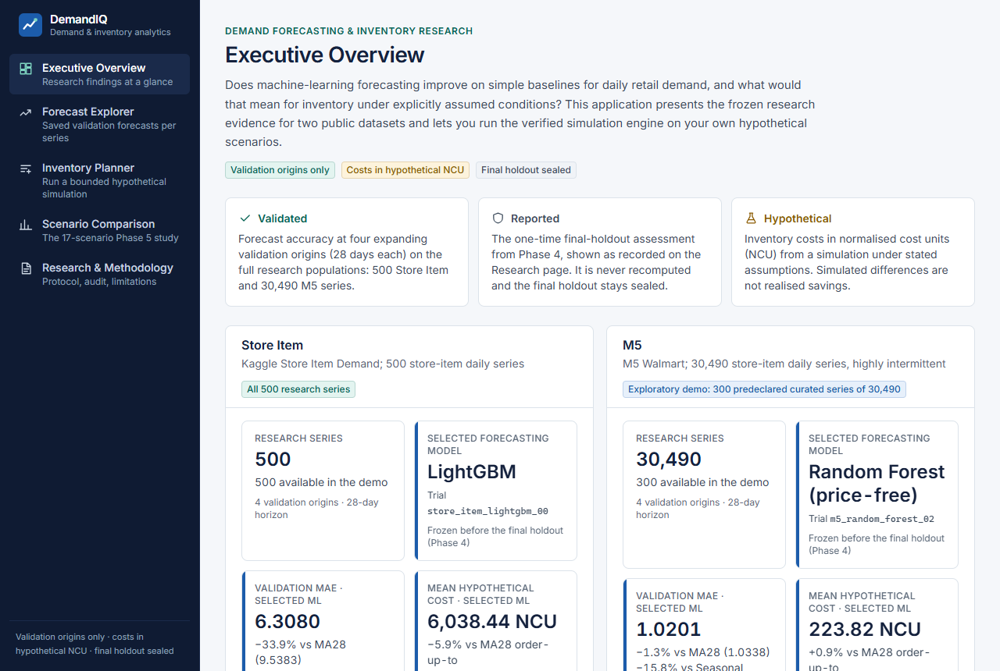
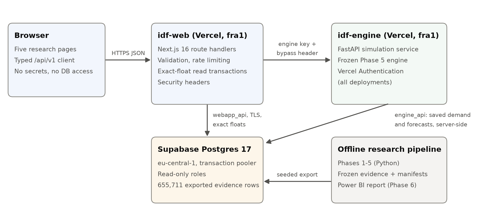
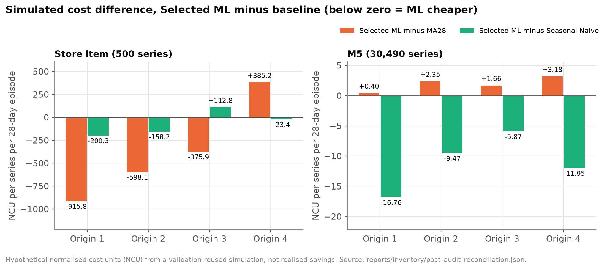
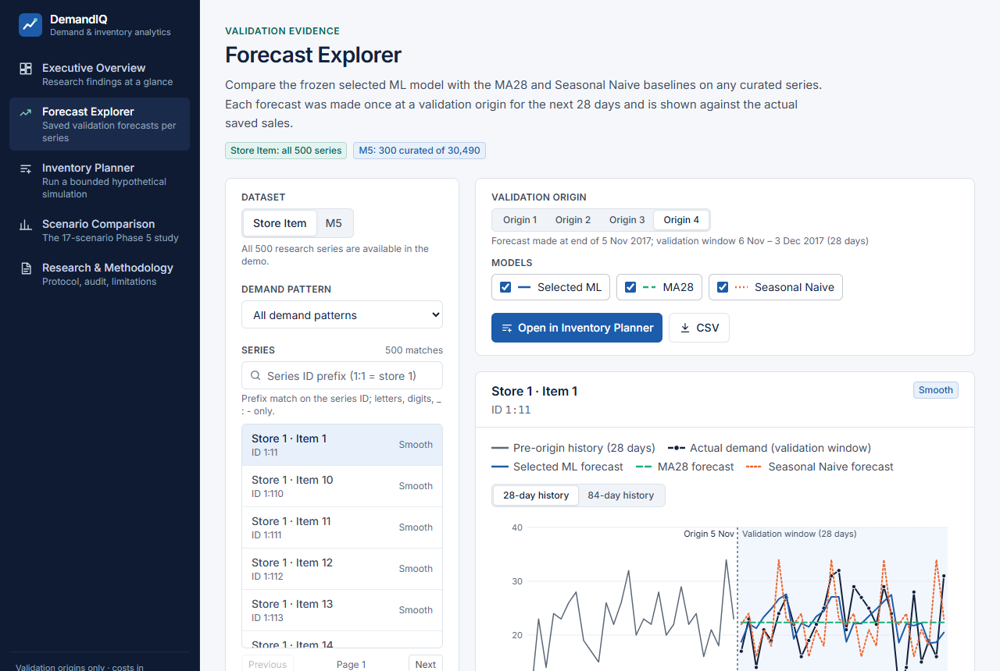
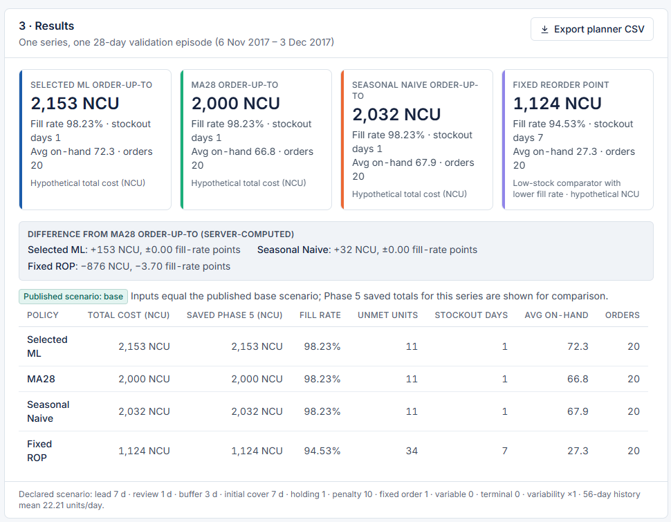

# Intelligent Demand Forecasting & Inventory Optimisation

*Research project (2026). Publication-safe summary: it contains no
credentials, infrastructure identifiers or dataset files. The source repository remains private.*

**Live research application:** https://idf-web.vercel.app



## The question

Does machine-learning forecasting beat simple rules for daily retail demand, and what would the difference mean
for inventory under explicitly assumed conditions? I answered it on two public retail datasets with opposite
characters: regular, seasonal **Store Item** demand (500 series) and intermittent **M5 / Walmart** demand
(30,490 series; almost 69% of series-day observations are zero).

## What I built

- **A governed forecasting benchmark.** Thirteen methods were compared under one protocol: naive and seasonal
  baselines, exponential smoothing, Croston/SBA/TSB, and global random-forest and LightGBM models. Every full-population
  method forecast all series 28 days ahead from four expanding validation origins (ARIMA and SARIMA ran on
  stratified subsets only).
- **A sealed final evaluation.** The selection was frozen and fingerprinted, the final forecasts were sealed, and
  each holdout was read exactly once, as recorded in a hash-chained ledger.
- **An audited inventory simulation.** A deterministic lost-sales simulator ran four replenishment policies over
  544 cases and 8.4 million series-episodes, in hypothetical cost units.
- **A Power BI report** of five pages and 69 DAX measures, whose 43-rule QA (42 pass, 1 cosmetic warning)
  reconciles its measures with the saved evidence.
- **A deployed research application.**
  - A Next.js front end, a protected FastAPI simulation service running the frozen engine, and a PostgreSQL
    evidence database.
  - Verified byte-for-byte against the local reference; it exposes curated series (all 500 Store Item and
    300 of 30,490 M5 series).



## Key verified results

| Result | Store Item | M5 |
|---|---|---|
| Selected model | LightGBM (global, recursive) | Random forest (global, recursive, price-free) |
| Final-holdout MAE vs best simple baseline | 5.43 vs 12.81 (−57.6% vs seasonal naive) | 1.047 vs 1.066 (−1.7% vs 28-day moving average) |
| Ranking robust across metrics? | Yes | No: worse than MA28 on macro MASE |
| Simulated cost vs MA28 (hypothetical) | Cheaper at 3 of 4 origins; reverses at the last | Costlier at all 4 origins |
| Simulated cost vs seasonal naive (hypothetical) | −1.10% pooled; costlier at origin 3 | Cheaper at all 4 origins (−4.69%) |

**The lesson.** Machine learning helped a lot where demand is regular and barely at all where it is
intermittent. Better accuracy did not reliably lower simulated inventory cost, because order-up-to policies
react to the forecast level as well as its error.



## Engineering highlights

- **Leakage control by construction.** Features use only data strictly before each target date. Tests poison
  future values. Prices were excluded because their publication timing could not be verified.
- **Reproducibility.** Hash-bound data and evidence, frozen manifests, independent recomputation (exact to the
  last digit) and an external-style audit with every finding dispositioned.
- **Production rigour.** Requiring exact parity exposed a silent precision defect: the database rounded floats to
  15 digits, which changed integer inventory results for 182 of 3,200 cases. It was fixed with binary and
  exact-output float transport.
- **Security.**
  - No credentials in the browser.
  - Read-only database roles.
  - The engine is reachable only server-to-server.
  - Input validation, rate limiting, security headers and safe error handling.

## Technology

Python 3.14 (pandas, NumPy, scikit-learn, LightGBM, statsmodels), pytest, Power BI (PBIP, DAX), Next.js 16,
React 19, TypeScript, FastAPI, PostgreSQL 17, Vercel.

## Responsible limitations

- Sales are a censored proxy for demand.
- The inventory study is hypothetical and reuses the validation windows, which favours ML.
- Four adjacent origins and one final window do not support significance claims.
- Costs are normalised units, not money, and no savings are claimed.
- The results come from two public datasets and are not a universal ranking.

## Reproducing the work

Access to the private repository can be provided to examiners. The Kaggle datasets must be obtained by the reader
from Kaggle; the raw files are not redistributed. The owner's review of the competitions' data-use terms, which
governs the public display of curated daily sales, is pending. Saved-artefact verification scripts reproduce the
published numbers without retraining:

```powershell
.\.venv\Scripts\python.exe final_submission\_verification\verify_validation.py   # validation MAE from saved forecasts
.\.venv\Scripts\python.exe final_submission\_verification\verify_phase5.py       # inventory results from raw outputs
```

| Screens | |
|---|---|
|  |  |
