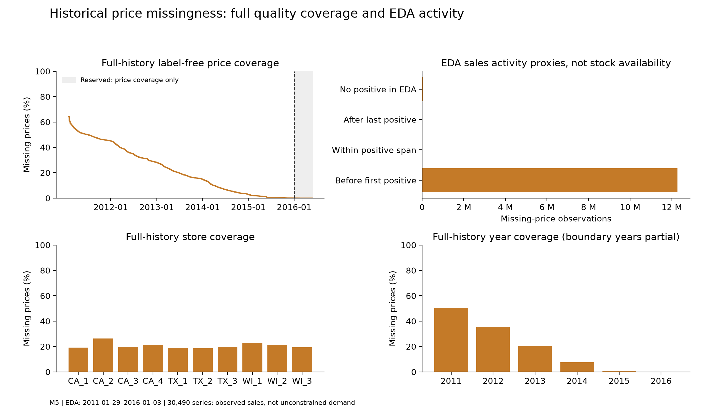

# M5: sales patterns and forecasting implications

## Executive summary

- Across all 30,490 series, 68.8374% of EDA observations are zero sales.
- The largest full-window descriptive class is intermittent (23,044 series). Removing leading zeros changes 1,288 class assignments.
- The top 10% of products account for 51.68% of EDA sales units.

## Scope and holdout protection

All series are included; EDA targets cover **2011-01-29–2016-01-03** (54,912,490 observations). Four later 28-day validation windows and the final 28-day holdout were reserved before detailed exploration. Full-history figures below are Phase 1 reconciliation references, not model-selection evidence.

Full-history reference: 59,181,090 rows and 66,927,173 units, independently rechecked while scanning.

## Distribution, scale and concentration

EDA sales total: **61,066,490 units**. Exact empirical unit quantiles (inverse CDF): `{'0.5': 0, '0.9': 3, '0.95': 5, '0.99': 15, '0.999': 47, '1.0': 763}`. Median series coefficient of variation of all daily sales is 2.080. Largest observed quantities are retained in the largest_observations table; they are not automatically labelled errors or removed.

## Calendar structure, trend and volatility

Within complete weeks, Saturday has the highest average sales ratio (1.210); Wednesday has the lowest (0.875). The table contains 95% pointwise intervals from 500 moving-block bootstrap replicates (4 weeks/block, fixed seed). These describe historical stability under block-resampling assumptions, not causal weekday effects or confirmatory multiple tests.

Aggregate diagnostic weekly strength is 0.109; annual strength after weekly removal is 0.774. These are log1p aggregate STL variance-ratio diagnostics, not forecast scores. The 365-day annual approximation does not exactly align leap days. Monthly indices use complete years and normalise by each year's daily mean to reduce level-trend confounding.

Median per-series lag-7 correlation: 0.175; lag-365: 0.030. Level correlations can reflect trend. The aggregate ACF figure also shows first-differenced log sales, with no misleading iid significance bands.

## Series-level intermittency

ADI is observed days divided by positive-sale days. CV² uses sample variance of positive sale sizes divided by their squared mean (ddof=1). Thresholds are 1.32 and 0.49; equality enters the high group. All-zero and one-positive histories remain separate undefined cases. This descriptive daily-sales convention is inspired by Syntetos–Boylan–Croston, not a universal model-selection rule; pre-launch zeros, censoring and temporal aggregation can change classes.

| Pattern | Full EDA window | First-positive-to-EDA-end sensitivity |
|---|---:|---:|
| smooth | 983 | 1,888 |
| erratic | 489 | 872 |
| intermittent | 23,044 | 22,139 |
| lumpy | 5,953 | 5,570 |
| all_zero | 16 | 16 |
| insufficient_positive_history | 5 | 5 |

The active-span sensitivity removes leading zeros analytically, without changing source observations or asserting actual availability. No trailing-zero truncation is used.

Illustrations select the median-ranked series within each class, ordered by zero percentage, mean units and series ID. They are not a random sample or the basis of population findings; all per-series statistics use the full published series population.

## Historical price missingness

All 12,299,413 full-history missing prices reconcile by date, year, store and product. Of these, 465 occur outside the EDA window; reserved targets are not stratified by their sales activity. The following activity partition uses EDA dates only and reconciles exactly:

| Observed activity relation | Missing-price observations |
|---|---:|
| missing_before_first_positive | 12,270,132 |
| missing_between_first_last_positive | 0 |
| missing_after_last_positive | 0 |
| missing_no_positive_in_eda | 28,816 |

Missing prices with positive EDA sales: **0**; with zero EDA sales: **12,298,948**. First/last positive sales are activity proxies. Temporal concentration can be consistent with assortment/launch effects but does not prove product availability, stockouts or the reason prices are absent. No price is imputed. The missingness mask is retained in analytical summaries. Observed historical prices are not assumed known over a future forecast horizon.

Calendar/event/SNAP summaries are associations. Event dates overlap across names, sample sizes differ, and trend/seasonality/store composition can confound comparisons. They do not estimate causal promotional effects.

## Evidence and reproducibility

All chart inputs and analytical tables are in `tables/m5/` as compressed Parquet. The adjacent results JSON records scope, settings, split dates, reconciliations and source hashes. Figures are exported as PNG and SVG. Inputs are hashed before and after; no raw/canonical file changes.

Methods: [Syntetos–Boylan–Croston classification](https://doi.org/10.1057/palgrave.jors.2601841); [forecast accuracy and rolling-origin evaluation](https://otexts.com/fpp3/toolbox.html). No forecasting model or hyperparameter search was run.
